# Bài 5: Ứng dụng Quản lý khóa học

Ứng dụng di động bằng **React Native + Expo SDK 57**, JavaScript và MockAPI REST API. Giao diện pastel.

## Chức năng
- Hiển thị khóa học, tìm kiếm không dấu, lọc danh mục từ API.
- Xem chi tiết, ảnh bìa URL, học phí, giảng viên, mô tả, thời lượng.
- Thêm / sửa / xóa khóa học qua API; xác nhận xóa và kiểm tra dữ liệu.
- CRUD danh mục từ API; kiểm tra phía ứng dụng để không xóa danh mục đang có khóa học.
- Trailer YouTube phát trong WebView; trạng thái loading, lỗi kết nối và danh sách rỗng.

## Cài đặt
Yêu cầu Node.js, npm và Expo Go tương thích với SDK.

~~~bash
npm install
npx expo start --lan
~~~

Dùng iPhone kết nối cùng mạng với máy Mac và quét mã QR bằng Expo Go.

## Đường dẫn MockAPI
https://6ad61022f71f154ac4866450.mockapi.io

| Phương thức | Endpoint | Chức năng |
| --- | --- | --- |
| GET, POST | /categories | Danh sách / thêm danh mục |
| PUT, DELETE | /categories/:id | Sửa / xóa danh mục |
| GET, POST | /courses | Danh sách / thêm khóa học |
| GET | /courses/:id | Chi tiết khóa học |
| PUT, DELETE | /courses/:id | Sửa / xóa khóa học |

Liên kết 1–N qua courses.categoryId = categories.id. Tên danh mục lấy từ API, không hardcode.

## Cấu trúc source
~~~text
App.js                 Stack Navigator và nút hành động
src/
  screens/             Danh sách, chi tiết, form, danh mục, trailer
  components/          CourseCard
  services/            Axios, courseService, categoryService
  config/              mockapi.json
assets/                Ảnh ứng dụng
~~~

## Kiểm thử trước khi nộp
1. Thêm / sửa / xóa khóa học, xác nhận dữ liệu trên MockAPI.
2. Tìm kiếm, lọc, xem chi tiết và phát trailer.
3. Thêm danh mục thử, thêm khóa học vào danh mục đó rồi thử xóa: phải báo không thể xóa.
4. Chuyển/xóa khóa học thử, sau đó xóa danh mục thử thành công.
5. Kiểm tra kết nối lỗi, dữ liệu rỗng.

> Chỉ thử xóa dữ liệu mới tạo, không xóa 10 khóa học mẫu.

<!-- SHOWCASE_START -->
## 🎬 Video thuyết trình

Nhấn ảnh bên dưới để mở **video demo thực tế** được lưu trên GitHub Releases.

**[▶ Xem hoặc tải video thuyết trình (.mov, khoảng 63 MB)](https://github.com/Minhhanh-zit/PTUDDD_Bai5/releases/download/v1.0-demo/ScreenRecording_10-20-2026.00-12-22_1.mov)**

[Trang phát hành video trên GitHub](https://github.com/Minhhanh-zit/PTUDDD_Bai5/releases/tag/v1.0-demo)

## 📱 Hình ảnh minh chứng

### Các thao tác chính

| | |
|:--:|:--:|
| 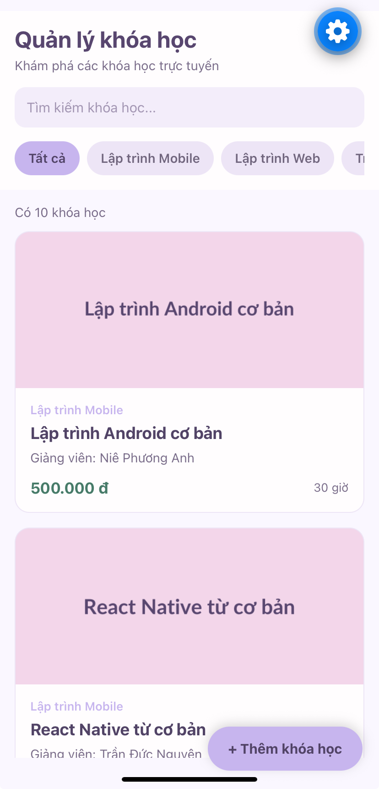 | 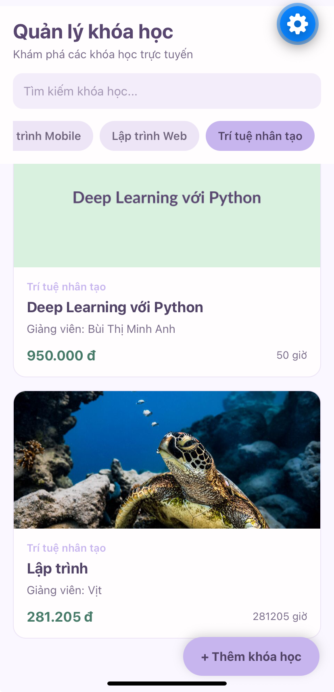 |
| **Danh sách khóa học** | **Lọc khóa học theo danh mục** |
| 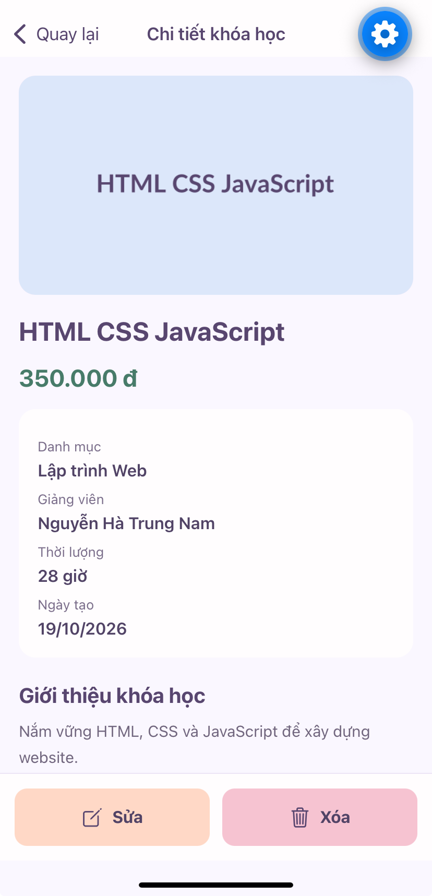 | 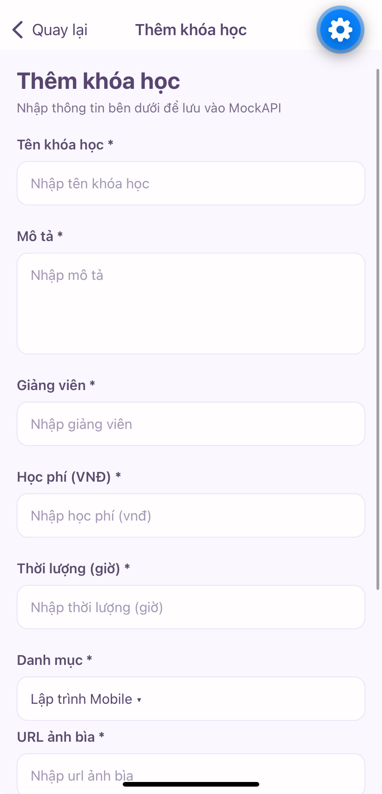 |
| **Chi tiết khóa học** | **Form thêm khóa học** |
| 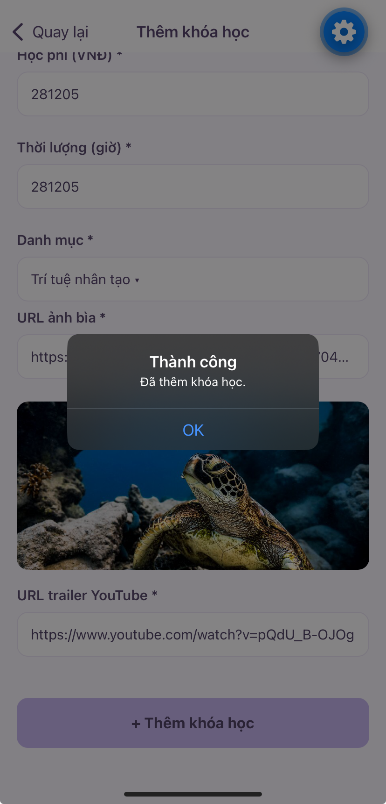 | 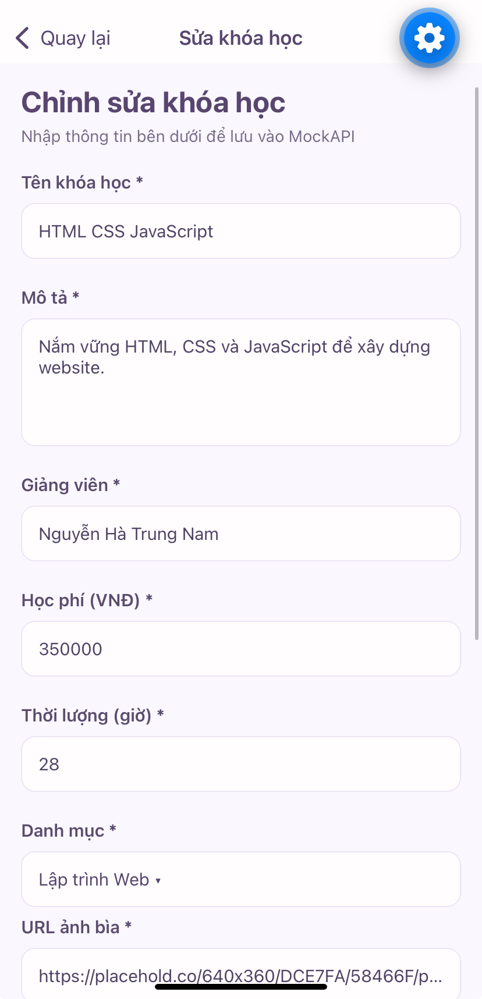 |
| **Thêm khóa học thành công** | **Form sửa khóa học** |
| 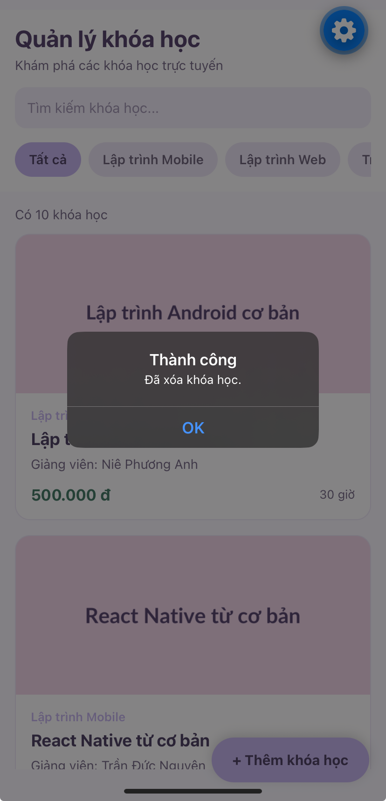 | 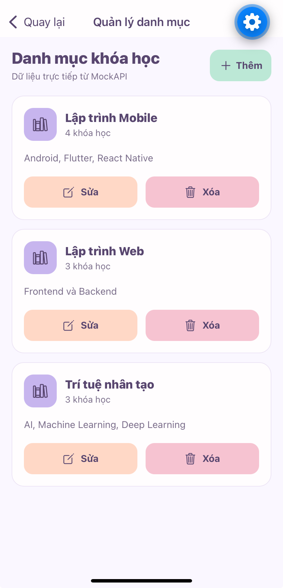 |
| **Xóa khóa học thành công** | **Danh sách danh mục** |
| 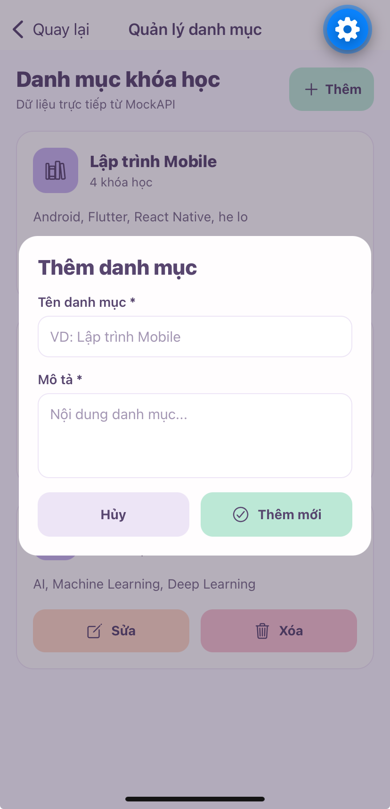 | 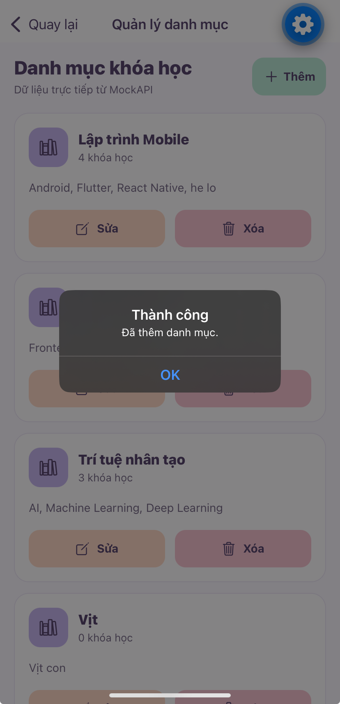 |
| **Biểu mẫu thêm danh mục** | **Thêm danh mục thành công** |
| 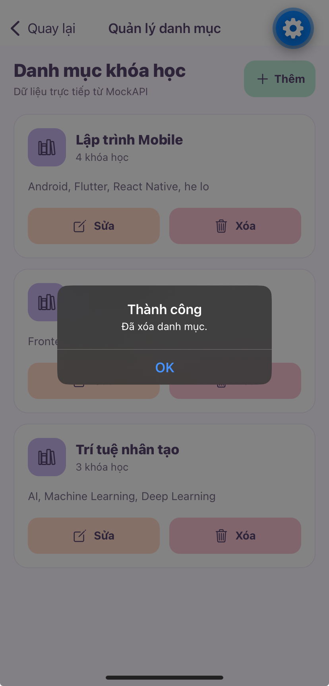 | 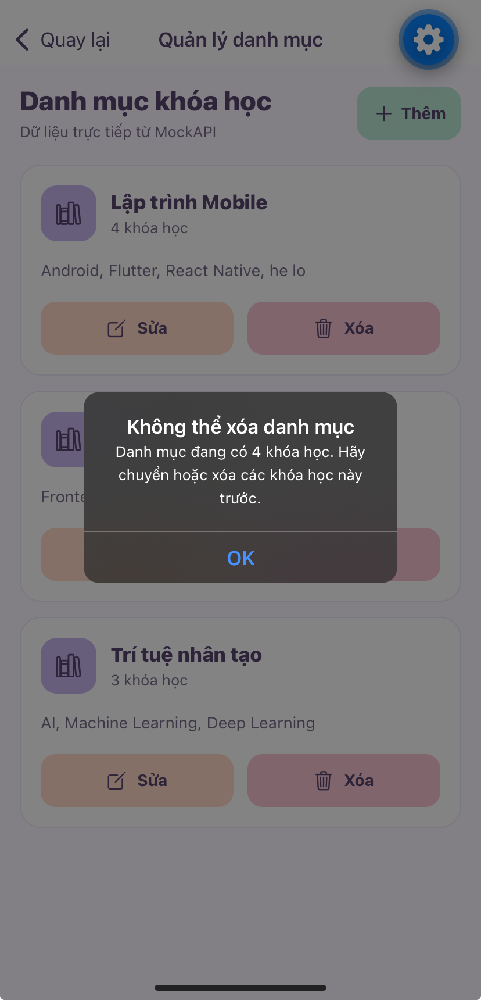 |
| **Xóa danh mục thành công** | **Chặn xóa danh mục đang có khóa học** |

<strong>Xem danh sách đầy đủ 23 ảnh minh chứng</strong>

- [01. Danh sách khóa học](docs/screenshots/01-danh-sach-khoa-hoc.png)
- [02. Chi tiết khóa học](docs/screenshots/02-chi-tiet-khoa-hoc.png)
- [03. Sửa khóa học thành công](docs/screenshots/03-sua-khoa-hoc-thanh-cong.png)
- [04. Form sửa khóa học](docs/screenshots/04-form-sua-khoa-hoc.png)
- [05. Dữ liệu sau khi sửa](docs/screenshots/05-khoa-hoc-sau-khi-sua.png)
- [06. Form thêm khóa học](docs/screenshots/06-form-them-khoa-hoc.png)
- [07. Thêm khóa học thành công](docs/screenshots/07-them-khoa-hoc-thanh-cong.png)
- [08. Dữ liệu thêm khóa học](docs/screenshots/08-du-lieu-them-khoa-hoc.jpeg)
- [09. Lọc khóa học theo danh mục](docs/screenshots/09-loc-khoa-hoc.png)
- [10. Chi tiết khóa học mới](docs/screenshots/10-chi-tiet-khoa-hoc-moi.png)
- [11. Xác nhận xóa khóa học](docs/screenshots/11-xac-nhan-xoa-khoa-hoc.png)
- [12. Xóa khóa học thành công](docs/screenshots/12-xoa-khoa-hoc-thanh-cong.png)
- [13. Danh sách danh mục](docs/screenshots/13-danh-sach-danh-muc.png)
- [14. Biểu mẫu sửa danh mục](docs/screenshots/14-form-sua-danh-muc.png)
- [15. Thao tác sửa danh mục](docs/screenshots/15-nhap-sua-danh-muc.png)
- [16. Sửa danh mục thành công](docs/screenshots/16-sua-danh-muc-thanh-cong.png)
- [17. Biểu mẫu thêm danh mục](docs/screenshots/17-form-them-danh-muc.png)
- [18. Thêm danh mục thành công](docs/screenshots/18-them-danh-muc-thanh-cong.png)
- [19. Xác nhận xóa danh mục](docs/screenshots/19-xac-nhan-xoa-danh-muc.png)
- [20. Xóa danh mục thành công](docs/screenshots/20-xoa-danh-muc-thanh-cong.png)
- [21. Điều hướng quản lý danh mục](docs/screenshots/21-nut-quan-ly-danh-muc.png)
- [22. Chặn xóa danh mục đang có khóa học](docs/screenshots/22-chan-xoa-danh-muc-co-khoa-hoc.png)
- [23. Phát trailer trong ứng dụng](docs/screenshots/23-phat-trailer-trong-ung-dung.png)

<!-- SHOWCASE_END -->
